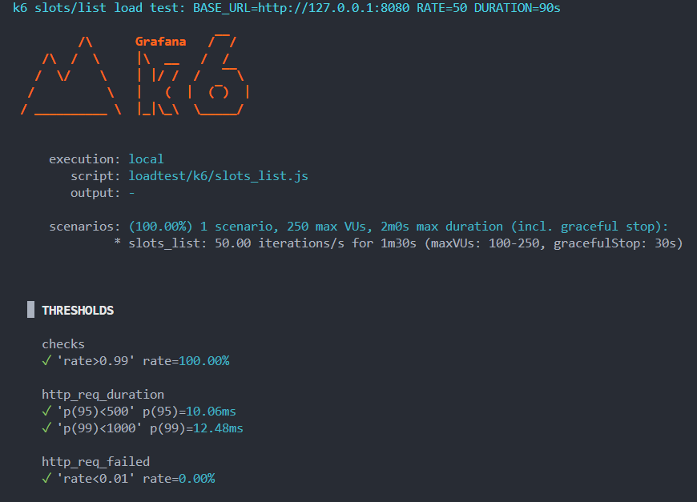
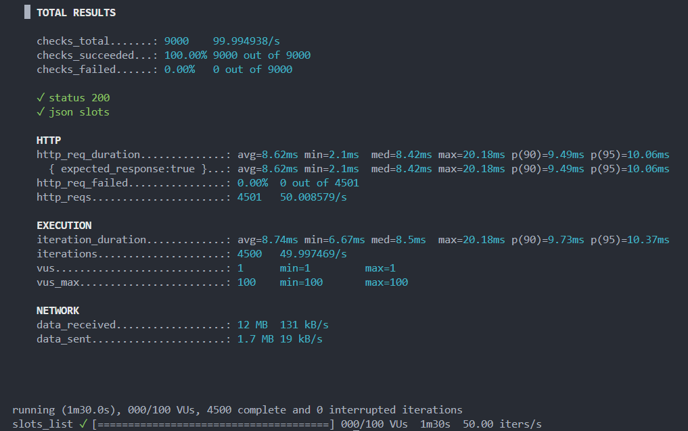

# Нагрузочное тестирование

Цель из [TASK.md](../TASK.md): оценить поведение под нагрузкой; самый нагруженный эндпоинт — **`GET /api/rooms/{roomId}/slots/list`** (ориентир по времени ответа ~200 мс p95).

## Подготовка

1. Поднять стек: `docker compose up -d --build` (или `make up`).
2. Заполнить БД: `make seed` (нужны переговорка с ID `11111111-1111-4111-8111-111111111101` и расписание из сидера).
3. Установить [k6](https://grafana.com/docs/k6/latest/set-up/install-k6/) **или** использовать Docker (см. ниже).

## Запуск

Из корня репозитория:

```bash
# по умолчанию ~50 req/s, 90s, BASE_URL=http://127.0.0.1:8080
make loadtest

# как в формулировке задания (~100 RPS)
make loadtest LOADTEST_RATE=100 LOADTEST_DURATION=2m

# быстрая проверка, что сценарий и токен работают
make loadtest-smoke
```

Переменные: `BASE_URL`, `LOADTEST_ROOM_ID`, `LOADTEST_RATE`, `LOADTEST_DURATION` (см. комментарии в `k6/slots_list.js`).

### Без установки k6 (Docker)

```bash
docker run --rm -i --add-host=host.docker.internal:host-gateway \
  -e BASE_URL=http://host.docker.internal:8080 \
  -e LOADTEST_RATE=50 \
  -e LOADTEST_DURATION=90s \
  grafana/k6:0.57.0 run - <loadtest/k6/slots_list.js
```

На Linux при необходимости замените `BASE_URL` на IP хоста вместо `host.docker.internal`.

## Что смотреть в выводе k6

- **http_req_duration** — p95/p99 (сравнивать с целевым SLA для слотов).
- **http_req_failed** — доля ошибок (в скрипте порог &lt;1% для основного сценария).
- **checks** — доля запросов с HTTP 200 и телом `{ "slots": [ ... ] }`.

## Краткие результаты

Фактический прогон: `.\tasks.ps1 loadtest` (k6, `BASE_URL=http://127.0.0.1:8080`).

| Параметр                  | Значение                                                                                                                                                |
| ------------------------- | ------------------------------------------------------------------------------------------------------------------------------------------------------- |
| Дата прогона              | 2026-04-04                                                                                                                                              |
| Окружение                 | Docker Compose (app + Postgres), хост Windows; k6 локально                                                                                              |
| Сценарий                  | `loadtest/k6/slots_list.js`                                                                                                                             |
| RPS (целевой / факт)      | 50 / **~50.01** (`http_reqs`: 4501 за 90s)                                                                                                              |
| Длительность              | **90s** (1m30s сценария + graceful stop до ~2m wall)                                                                                                    |
| **http_req_failed**       | **0.00%** (0 из 4501)                                                                                                                                   |
| **http_req_duration p95** | **10.06ms**                                                                                                                                             |
| **http_req_duration p99** | **12.48ms**                                                                                                                                             |
| **checks**                | **100.00%** (9000 проверок: `status 200`, `json slots`)                                                                                                 |
| Замечания                 | Все пороги k6 пройдены (`p(95)<500`, `p(99)<1000`, `http_req_failed<1%`, `checks>99%`). Средняя задержка **~8.62ms**, max **~20.18ms**. Итераций: 4500. |

## Скриншоты результатов нагрузочного тестирования k6




